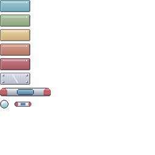

#  IA Arkanoid

Arkanoid variant with JSON maps for training and evaluating AI agents, built on [`ai-game-framework`](https://pypi.org/project/ai-game-framework/).

---

## Architecture & Features

1. **Backend Simulation Engine (`server/logic.py`)**:
   - `numpy`-based swept (continuous) collision detection with specular reflection; constant ball speed.
   - **Scores**: raw score (`score`, the points of the whole game, summed over the levels) and the normalized score, a per-level metric (`normalized_score`: points per second of the current level; the clock and the points restart at every level; it is 0 for a level that ended without being cleared). The graded value is `avg_norm_score`: the mean over all the levels of the sequence of their normalized score, where a level that was not cleared (or not reached) counts 0, so only cleared levels earn it and stalling or dying early is not rewarded.
   - **3-Region Paddle Physics** (angles from the vertical, triangular distribution inside each cone):
     - **Center third**: straight up (90° from horizontal) with a cone of ±α (`alpha_deg`, default 8°).
     - **Left third**: 45° to the left with a cone of ±β (`beta_deg`, default 15°).
     - **Right third**: 45° to the right with a cone of ±β.
     - α < β is enforced when `config.json` is loaded (`paddle.angles`: `alpha_deg`, `side_deg`, `beta_deg`).
   - **Scoring**: points are awarded only when a brick breaks (its `points` value) with no per-hit points and no stage-clear bonus; damaging a multi-hit brick or bouncing off metal scores nothing.

2. **Configuration & Maps (`consts.py`, `config.json`, `maps/`)**:
   - Constants defined in [`consts.py`](consts.py) and optionally loaded via [`config.json`](config.json) (screen dimensions, paddle size/speed, ball radius/speed, brick types, point values). Metal bricks award 0 points.
   - Maps stored in [`maps/`](maps/) as modular JSON files (supporting discrete virtual grid `(row, col)` or legacy canvas coordinates):
     - All bricks share uniform dimensions (50x20).
     - Variable health/durability (1-hit red, 2-hit blue, 3-hit green, 4-hit yellow).
     - **Indestructible Metal Bricks**: Deflect the ball without taking damage.
     - **Level Progression**: Advances to the next level when all destructible bricks are eliminated, even while metal bricks remain on screen.
   - Includes 3 pre-built levels:
     - [`maps/level1.json`](maps/level1.json): Classic assault wall with corner metal anchors.
     - [`maps/level2.json`](maps/level2.json): Diamond pyramid with tiered health bricks and metal bastions.
     - [`maps/level3.json`](maps/level3.json): Iron fortress with metal columns and 4-hit gold bricks.

3. **Frontend Visualizer (`viewer/viewer.py`)**:
   - Pygame-based desktop visualizer connecting via WebSocket.
   - Nord-palette pixel-art sprite sheet ([`assets/sprites.png`](assets/sprites.png), regenerated by `viewer/sprites.py`): gradient-shaded glossy bricks colored by remaining hits, riveted steel metal bricks, Vaus-style paddle with red end caps and a frost core, and a shaded ball.
   - Real-time arcade HUD showing stage, the time left until the level deadline (counts down from `level_time_limit`, red in the last 30 s; elapsed game time when the limit is 0), raw score, level rate (pts/s) and `avg_norm_score`, high score, and lives.

4. **Autonomous & Manual Agents (`agents/`)**:
   - [`DummyAgent`](agents/dummy_agent.py): Samples uniformly from `valid_actions` or stays idle.
   - [`ManualAgent`](agents/manual_agent.py): Interactive terminal keyboard driver with live ANSI HUD and A/D or Arrow keys.

5. **CI Pipeline & Pre-commit Quality Gate**:
   - Git pre-commit hooks (system-installed tools):
     - `ruff` (linter and import formatter)
     - `basedpyright` (static type checker)
     - `vulture` (dead code detection)
     - `unittest` (automated test discovery)
     - `coverage` (at least 80% test coverage)

---

## Documents

- Group assignment (guide): [English](assets/trab-grupo-arkanoid-en.pdf), [Portuguese](assets/trab-grupo-arkanoid-pt.pdf).
- Session slides (setup, metric, how to start): [presentation](assets/trab-grupo-arkanoid-slides.pdf).

## Quick Start

Run everything from the repository root (config, maps and assets use relative paths). Python 3.12 is the reference version (3.10 is the minimum supported). An agent running in inference mode can only rely on the libraries in `pyproject.toml`.

### 1. Create and activate the virtual environment

```bash
python3 -m venv venv
source venv/bin/activate        # Windows: venv\Scripts\activate
```

Create the venv once. Activate it in **each** terminal you use (the three terminals below).

### 2. Install the requirements

The requirements are declared in [`pyproject.toml`](pyproject.toml) (`[project] dependencies`: `ai-game-framework`, `numpy`, `pygame` (`pygame-ce` on Python 3.14 and newer), `websockets`). There is no `requirements.txt`; `pip` reads `pyproject.toml` directly. With the venv active, from the repository root:

```bash
pip install .
```

Do this step even if a venv is already active: creating or activating a venv does not install anything. Do not install `aigf` or similar by hand; the framework is the PyPI package `ai-game-framework` and is pulled in by the command above. Re-run `pip install .` after pulling changes that touch `pyproject.toml`. Use `pip install -e .` instead if you want edits to the packages to be picked up without reinstalling.

Check the install with `python -c "import aigf, numpy, pygame, websockets"`. If it fails with `ModuleNotFoundError`, the venv is not active or step 2 was skipped.

Python 3.14 or newer: `pygame` has no wheel for it and the source build ends with `font module not available` (circular import in `pygame.font`) when it misses the SDL2_ttf headers. `pyproject.toml` therefore asks for `pygame-ce` there (same `import pygame`). If you installed `pygame` in a 3.14 venv before, fix it with `pip uninstall -y pygame && pip install .`.

### 3. Launch three terminals

| Terminal | Role | Command |
|---|---|---|
| 1 | Backend (game server) | `python -m server.server` |
| 2 | Viewer (Pygame window) | `python -m viewer.viewer` |
| 3 | Agent (pick one) | `python -m agents.dummy_agent --id a12345` (bot) or `python -m agents.manual_agent --id a12345` (keyboard) |

Start the backend first, then the viewer, then the agent. The game starts when an agent connects; when it ends the server returns to the lobby and waits for a new agent.

Manual agent controls: `A` / Left Arrow = West, `D` / Right Arrow = East, `Q` = quit.

### Backend options

| Option | Short | Default | Description |
|---|---|---|---|
| `--fps N` | `-f` | `30` | Simulation ticks per simulated second (each agent action/state exchange is one tick). |
| `--acceleration X` | `-a` | `1.0` | Wall-clock speed-up. `10` runs ten times faster; simulated time per tick is unchanged, so agent dynamics stay identical. Use it to speed up training. |
| `--levels SPEC` | `-l` | all levels in `config.json` | `1`, `1,2,3`, `1-3` or mixed `1,3-5`. Level `N` is `maps/levelN.json`; a map file name also works. |
| `--level-time-limit S` | `-t` | `400` | Seconds of game time allowed per level (`0` disables). If not cleared in time the game ends (`timed_out`); advancing requires clearing the level. |
| `--seed S` | `-s` | `None` | PRNG seed for reproducible ball refractions, launch angles, and controlled evaluation runs. |
| `--share-highscore` | `-S` | off | Persist finished scores to local CSV (`highscores.csv`) and upload `avg_norm_score`. |
| `--host`, `--port`, `--config` | `-H`, `-p`, `-c` | `0.0.0.0`, `8765`, `config.json` | Network binding and config file path. |

Examples:

```bash
python -m server.server -a 10 -l 1-3                          # fast training run
python -m server.server -l 2 -S -s 42                         # seeded competition on stage 2
python -m server.server -l 3 -t 300                           # level 3 only, 5 minutes to clear it
```

### Level Designer & Simplified Map JSON (`tools/level_designer.py`)

Levels can be specified using a simplified virtual discrete grid `(row, col)` format (e.g. `{"row": 0, "col": 0, "type": "red"}`), omitting redundant pixel coordinates, canvas dimensions, and calculated colors/points.

The level designer utility provides ASCII conversion, validation, and an interactive Pygame editor:

```bash
python -m tools.level_designer -g                              # launch visual level designer GUI
python -m tools.level_designer -v -i maps/level1.json          # validate winnability / reachability
python -m tools.level_designer -c -i maps/level1.json -o out.json  # convert legacy x/y to grid format
python -m tools.level_designer -a layout.txt -o maps/new.json  # generate map from ASCII art
```

### Agent options

Both example agents (run from the repository root, with the venv active) take the same options:

| Option | Short | Default | Description |
|---|---|---|---|
| `--server URI` | `-s` | `ws://localhost:8765/ws` | WebSocket URI of the backend. |
| `--name TEXT` | `-n` | `Dummy Agent` / `Manual Arkanoid Driver` | Display name (required non-empty, max 32 chars). |
| `--id TEXT` | `-i` | `AGENT_ID` variable, else random | Agent id sent in handshake to rank it in the dashboard. |

```bash
python -m agents.dummy_agent -i a12345 -n "Random bot"                      # random bot
python -m agents.manual_agent -i a12345 -s ws://192.168.1.10:8765/ws        # keyboard, remote backend
```

The id comes from, in this order:

1. `--id` on the command line, which overrides everything else;
2. the `AGENT_ID` string variable at the top of the agent module (`AGENT_ID: str | None = None`; set it to your id, e.g. `AGENT_ID = "a12345"`);
3. otherwise a random one (`uuid.uuid4().hex`, generated by the agent). A random id changes at every run, so such a run cannot be tracked in the dashboard.

The backend keeps only `[A-Za-z0-9._-]` and at most 64 characters of the id (empty after cleaning: it generates a random one) and includes it in the uploaded score (below).

Custom agents subclass `BaseAgent(server_uri, name, agent_id)` and implement `deliberate()`; when the agent stops (game won, game over, level time limit reached, connection lost) `BaseAgent` prints a summary on the terminal (stop reason, level, score, `avg_norm_score`, game time, lives, high score); `BaseAgent` resolves the id (`agent_id` or random) and sends `{"client": "agent", "name": ..., "id": ...}` in the handshake. The viewer takes only `--server` (WebSocket URI, default `ws://localhost:8765/ws`).

### Remote highscore upload (HTTP PUT)

With `--share-highscore`, every finished game (game over or victory) is sent as one `PUT /api/v1/results` to the course dashboard, with this JSON body:

```json
{"player_id": "a12345", "player_name": "ann",
 "scores": {"levels_cleared": 2, "avg_norm_score": 31.5, "highscore": 4200},
 "play_time": 133.2, "setting": "1-3", "details": {"level": 2, "won": true, "timed_out": false}}
```

`player_id` is the agent id (see Agent options) and the key to rank by, `player_name` is the display name, `highscore` is the raw points, `avg_norm_score` is the graded value (the mean over all the levels of the sequence of each level's points per second, 0 for a level that was not cleared), `levels_cleared` is how many levels were cleared and `setting` the canonical label of the levels played (the sorted set of levels, runs compressed: `--levels 1,2,3`, `3,1,2` and the default all give `1-3`; `2`; `1,3`; the dashboard compares players with the same setting), `play_time` is the game time in seconds, `details.level` is the map number (`maps/levelN.json`) the game ended on, `won` is true when every level played was cleared and `timed_out` is true when a level exceeded its maximum duration. Rank by `avg_norm_score` and use `highscore` as the tie-break (and to sort the games that cleared nothing).

The endpoint is read from `ARKANOID_HS_URL` (default: the course dashboard `https://dashboard.av.it.pt/api/v1/results`, `DEFAULT_HIGHSCORE_URL` in [`server/remote.py`](server/remote.py)); the companion `aigf-dashboard` service accepts it at `/api/v1/results`. The upload-only token of the course dashboard is built into `server/remote.py` (`DEFAULT_TOKEN`), so every student can submit without setup; it can only upload. `ARKANOID_HS_TOKEN` overrides it. The token is sent as an `Authorization: Bearer <token>` header (set it in the environment, never as a CLI flag). `ARKANOID_HS_DRY_RUN=1` appends `?dry_run=true`: the dashboard validates the upload and stores nothing (use it to test the connection and the token). `ARKANOID_HS_TEST=1` sends `is_test: true`: the result is stored but hidden from the ranking and histogram. `player_name` is cut to 32 printable ASCII characters. The upload runs on a background thread with a 5 s timeout; failures are logged and never interrupt the game (the local CSV file still keeps the score). No retry queue yet. The service side is not part of this repo.

### High score file

With `--share-highscore`, every finished game is appended as one row to `highscores.csv` (git-ignored; columns `date,id,player,score,time_elapsed,avg_norm_score`, written with the standard `csv` module, so it opens in any spreadsheet). The in-game top-10 boards are rebuilt from this file at start-up on top of the arcade defaults. The file is plain text and is not tamper-proof: it is a local log, the ranking that counts is the one on the receiving server.

---

## Getting template updates

The template repository (`https://github.com/detiuaveiro/ia-arkanoid-template`) will receive bug fixes, new levels and the dashboard. A repository created from a template has its own history, so register the template once as `upstream` and merge from it whenever an update is announced:

```bash
git remote add upstream https://github.com/detiuaveiro/ia-arkanoid-template.git   # once
git fetch upstream
git merge upstream/main --allow-unrelated-histories    # first merge only; plain `git merge upstream/main` afterwards
pip install .                                          # in the active venv, in case pyproject.toml changed
```

Commit your work before merging. Files you did not touch merge cleanly; if there is a conflict, keep your changes in your own files (`student.py`, ...) and take the upstream version of the game files (`server/`, `viewer/`, `maps/`, `config.json`). Do not edit those: your agent is evaluated against the official versions.

---

## Testing & Code Quality

The quality tools (`ruff`, `basedpyright`, `vulture`, `coverage`, `pre-commit`) must be installed on the system, not in the venv.

```bash
# Run unit tests
python -m unittest discover -s tests

# Check code coverage
coverage run --source=server,agents -m unittest discover -s tests -q
coverage report --fail-under=80

# Enable and run the pre-commit hooks
pre-commit install
pre-commit run --all-files
```

---

## License

MIT, see [`LICENSE`](LICENSE).
